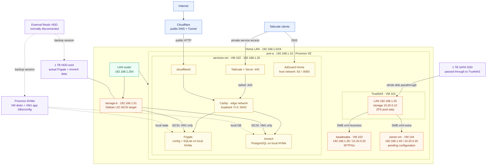

# Home Lab Wiki

Operational notes for rebuilding and running the lab. `00-current-state.md` is the source of truth; numbered files record build and recovery procedures. Secrets belong in the password manager, never here.

## Architecture

Public HTTP uses Cloudflare Tunnel → Caddy; Tailscale reaches `services-vm` directly for DNS, administration, and private HTTPS through Serve → Caddy. VM1 local NVMe owns Frigate configuration/SQLite and Immich PostgreSQL; the Build B HDD holds their actual media data through VM1’s exclusive iSCSI mount. Native SFTP uses VM2’s LAN/Tailscale address on port 2022.

## Read order

1. [00-current-state.md](00-current-state.md) — live inventory and invariants.
2. [10-operations-runbook.md](10-operations-runbook.md), then [11-troubleshooting-index.md](11-troubleshooting-index.md).
3. Build docs `01`–`08`, service docs `09`, `12`–`20`, then TrueNAS/VM docs `22`–`27`.
4. `28-build-b-outage-recovery.md` handles an outage; `28-future-iscsi-to-nfs-migration.md` is deferred.

## Non-negotiable rules

- Identify disks by `/dev/disk/by-id`, UUID, or PARTUUID; never by `sdX`.
- Build B ext4 is mounted through VM1 iSCSI or locally on Build B, never both.
- TrueNAS exclusively owns the passed-through SATA SSD and exports child datasets, not the pool root.
- Storage-dependent containers fail closed when their mount is absent.
- Only web frontends join Docker network `edge`; databases and caches stay private.
- Explicit Cloudflare routes are public; wildcard private DNS points to VM1’s Tailscale address.
